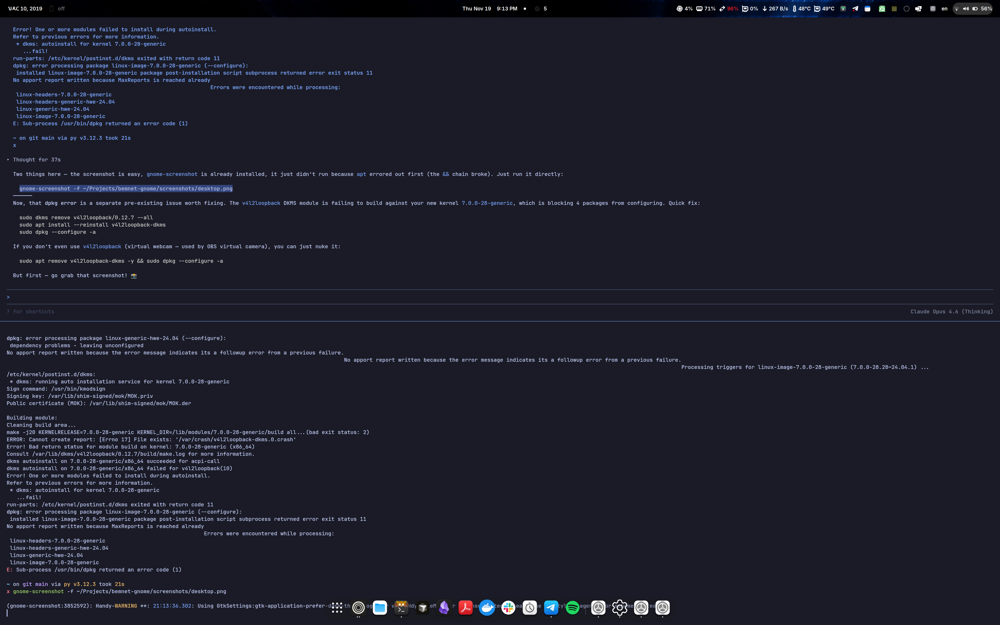
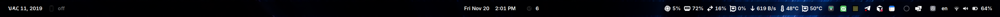
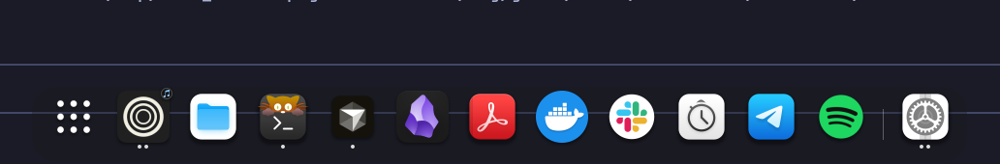
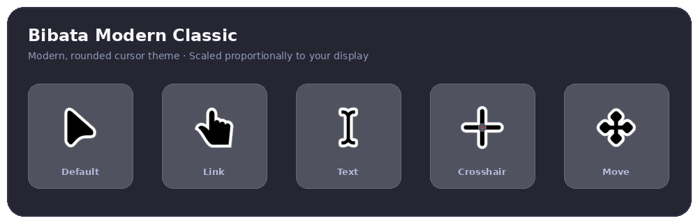

# bemnet-gnome

Ubuntu GNOME desktop setup: Orchis Grey Dark theme, WhiteSur icons, Bibata Modern cursor, frosted top bar with live system vitals + Ethiopian calendar, smooth window effects, auto-hiding magnification dock, workspace shortcuts, and trackpad gestures.



| | |
|---|---|
| **OS** | Ubuntu 24.04 LTS (Noble Numbat) |
| **Shell** | GNOME 46 |
| **Session** | Ubuntu on Xorg (required for trackpad gestures) |
| **Theme Stack** | Orchis-Grey-Dark · WhiteSur Icons · Bibata Modern Classic Cursor |

---

## Visual Showcase

### Frosted Top Panel
Live system vitals (CPU, RAM, temps), Ethiopian calendar (Amharic), clock, and media controls integrated into a frosted translucent bar.



### Fluid macOS-Style Dock
Auto-hiding bottom dock with smooth icon magnification curve (`1.48` scale, `155` falloff, `160ms` duration) and rounded border radius dynamically matched to the top panel.

<div align="center">
  
</div>

### Bibata Modern Classic Cursor
Rounded, modern cursor theme automatically scaled and configured across GNOME, GTK 3, GTK 4, legacy X11, and sandboxed Snap/Flatpak apps.

<div align="center">
  
</div>

---

## Install with an agent (recommended)

```bash
git clone https://github.com/BemnetMussa/bemnet-gnome.git
cd bemnet-gnome
cursor .
```

Ask the agent (copy-paste):

> Set up this Ubuntu GNOME customization. Follow AGENTS.md and run the installer now — including extensions, CopyQ, Pomodoro, and scale adaptation. Do not only explain.

The agent reads [`AGENTS.md`](AGENTS.md) + `.cursor/rules/agent-setup.mdc` and runs `./install.sh` (sudo + network).

When finished: log out → gear on the login screen → **Ubuntu on Xorg** → log in.

---

## Manual install

```bash
git clone https://github.com/BemnetMussa/bemnet-gnome.git
cd bemnet-gnome
chmod +x install.sh scripts/install-extensions.sh scripts/adapt-to-scale.sh
./install.sh
```

| Command | Purpose |
|---------|---------|
| `./install.sh` | Full install: deps, themes, icons, cursor, extensions, configs, dconf + scale adapt |
| `./install.sh --settings-only` | Re-apply configs and dconf (after installing extensions) |
| `./install.sh --themes-only` | Themes, WhiteSur icons, and Bibata cursor only |
| `./scripts/install-extensions.sh` | Extensions only |
| `./scripts/adapt-to-scale.sh` | Dynamically re-fit dock, panel, and cursor to any screen |

---

## What you get

- **Orchis-Grey-Dark** — GTK and GNOME Shell theme  
- **WhiteSur** icons with a clearer panel status overlay  
- **Bibata Modern Classic** — rounded, modern cursor theme  
- **Just Perfection** — cleaner top bar, smoother workspace animation, wrap-around  
- **Blur my Shell** — frosted panel and overview blur  
- **Vitals** — top-bar CPU / RAM / swap / GPU / network / temps  
- **EthCal** — Ethiopian calendar on the top bar (Amharic)  
- **Burn My Windows** — smooth glide window open/close  
- **Magic Lamp** — Compiz-style snappy minimize animation  
- **MacOS Dock** — fluid magnification dock with auto-hide  
- **X11 Gestures + Touchégg** — 3/4-finger trackpad gestures  
- **Pop Shell** — optional tiling (off by default)  
- **Auto Move Windows** — auto-assign apps to workspaces (Brave→1, Cursor→2, Obsidian→3)  
- **Listening Ports** — top-bar dev monitor: see which apps are listening, open/copy/stop  
- **Follow** — start/stop OpenHands Canvas on Tailscale, scan QR from your phone  
- **CopyQ** — clipboard history (autostarts with the session)  
- **Pomodoro** — focus timer in the top bar  
- **Universal Scale Adaptation** — automatically computes proportional dock icon, corner radii, and cursor size (`24px`–`64px`) for any laptop, 1080p, 1440p, or 4K monitor without touching your system display scale!

Extension list: [`extensions.txt`](extensions.txt)

---

## Shortcuts

| Shortcut | Action |
|----------|--------|
| **Alt+Tab** | Switch windows (same workspace) |
| **Ctrl+Alt+A** / **Ctrl+Alt+D** | Workspace left / right |
| **Ctrl+Alt+Shift+A** / **D** | Move window to workspace left / right |
| **Ctrl+Shift+C** | Open CopyQ clipboard history |
| **Ctrl+Alt+P** | Toggle Pomodoro timer |

## Gestures

| Gesture | Action |
|---------|--------|
| 3 / 4-finger swipe | GNOME Shell gestures |
| 3-finger pinch in | Close window |
| 4-finger pinch out | Show desktop |
| 4-finger pinch in | App grid |
| 2 / 3-finger tap | Right / middle click |

## Layout

```text
bemnet-gnome/
├── AGENTS.md
├── install.sh
├── scripts/install-extensions.sh
├── scripts/adapt-to-scale.sh
├── extensions.txt
├── screenshots/    # desktop, top-bar, dock, cursor-preview
├── dconf/          # themes, dock, vitals, ethcal, shortcuts, …
├── configs/
└── icons/WhiteSur-Panel/
```

## Universal Display Adaptation

The installer automatically runs `scripts/adapt-to-scale.sh`. It detects the screen resolution, scaling mode, and text scale to compute:
- Proportional **dock icon sizes** and **magnification falloff curve**
- Matching **border radii** between the floating dock and frosted top panel
- Proportional **cursor size** (`24px`, `28px`, `32px`, `36px`, `48px`, or `64px`)
- **System-wide cursor fallback** across GNOME, GTK 3/4, legacy X11, and Snap sandboxes

The installer **never** forces or changes your display resolution or text-scaling factor.

## Credits

[Orchis](https://github.com/vinceliuice/Orchis-theme) · [WhiteSur icons](https://github.com/vinceliuice/WhiteSur-icon-theme) · [Bibata Cursor](https://github.com/ful1e5/Bibata_Cursor) · [Touchégg](https://github.com/JoseExposito/touchegg) · extension authors in `extensions.txt`

## License

MIT for scripts and configs in this repo. Upstream themes and extensions keep their own licenses.
